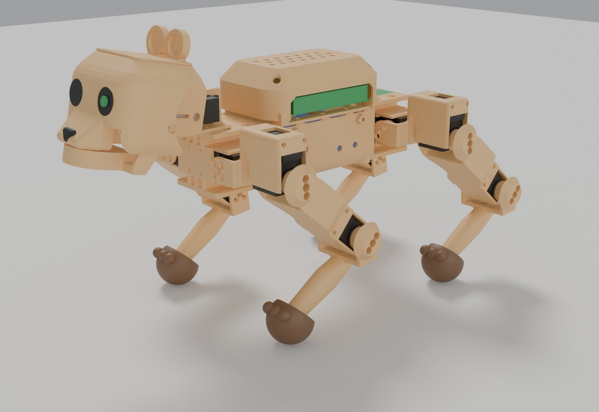
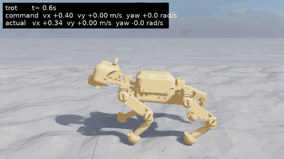
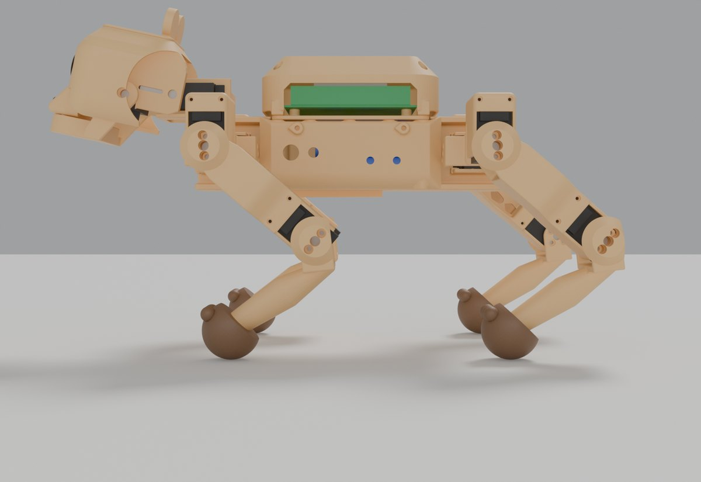
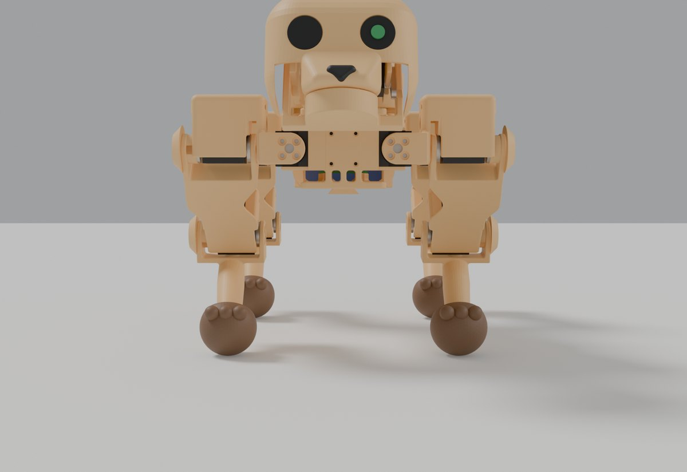
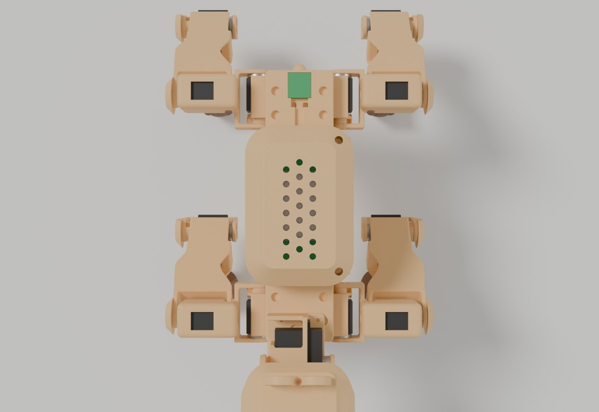
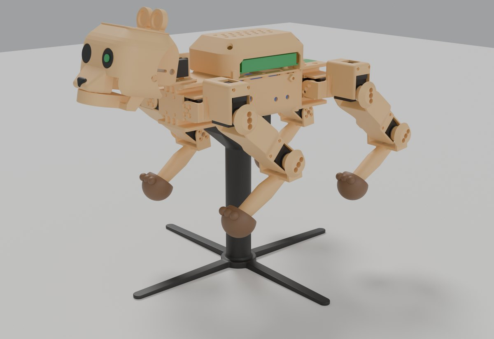
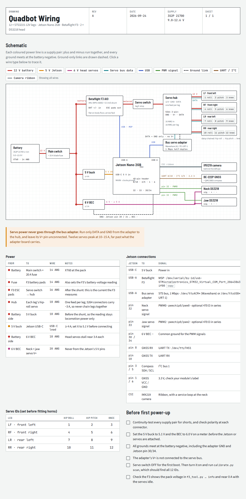

# quadbot: a baby‑bear quadruped (12 × STS3215, Jetson Nano 2GB)

A honey‑coloured cub: a big round head wider than its body, two eyes (the left one is the camera), a button nose, round ears, a back hump over the Jetson, chunky thighs, bean paws and a stub tail. The design critique that drove the look is in `docs/critique_baby_bear.md`.



### Trained to walk in simulation



The final "cat" locomotion policy in Isaac Lab, on the hardest terrain tiles: trot, sprint, a
2 rad/s turn and a sidestep. The caption shows commanded against actual speed. Full videos:
[hills and slopes](sim/runs/cat_final/quadbot_cat_terrain.mp4) ·
[flat course](sim/runs/cat_final/quadbot_cat_course.mp4).

| Side | Front | Top |
|:---:|:---:|:---:|
|  |  |  |



Renders: `cad/render_blender.py` (Blender Cycles) from the parametric model in `cad/`.

A four-legged robot with 3 joints per leg: hip roll → hip pitch → knee, all STS3215‑12V.
Every joint uses a **double U‑bracket**: it clamps both the output horn and the idler horn, so the
servo bearings never carry a cantilevered load. The body in between the joints is a sleeve that
the next servo slides into.

```
cad/params.py     all dimensions (edit here)
cad/geom.py       part geometry (manifold3d CSG, no CAD kernel needed)
cad/build.py      -> stl/*.stl, already rotated for printing
cad/check.py      collision sweep over the leg joint ranges;  cad/check_head.py  neck + jaw
cad/check_fit.py  every servo (case, horns, plugs) vs the part that holds it, plus material at every pivot
cad/check_body.py bending section properties of the body (+ deck) along its length
cad/audit.py      printability of every print-oriented STL: bed contact, overhangs > 55°, bridges > 12 mm, walls < 1.2 mm
                  (render_audit.py paints them red / orange in Blender renders seen from below)
cad/check_screws.py every horn screw (2.5 mm under the head, supplied 5.8 mm screws) and all 48 case screws (straight driver path, solid seat)
cad/assembly.py   posed assembly export;  cad/render_blender.py renders it
cad/export_blend.py + cad/blend_build.py  -> quadbot.blend (posable: rotate the LF_knee etc. empties about Z)
```
Rebuild: `cd cad && python3 build.py && python3 check.py LF`

## Key numbers
| | |
|---|---|
| hip spacing (fore/aft) | 200 mm |
| hip-pitch axis spacing (L/R) | 169 mm |
| upper leg / lower leg | 100 / 110 mm |
| standing height (stand pose) | ~145 mm hip axis to ground: a slightly crouched, playful cub stance (left legs 0, −49°, +93°; head 12° nose‑up) |
| joint ranges (collision‑free) | hip roll ≥ ±35° (LF −60…+50, RF −35…+60, LR −50…+60, RR −60…+50), hip pitch ±95°, knee −45…+145° (fold side) |
| neck / jaw | neck −55° (nose up) … +55° (nose down), +40° with the mouth open; jaw 0…90° (use 0…40) |
| soft limit | don't combine a front leg raised far forward (pitch < −60°), knee folded past 100° **and** rolled inward: the paw reaches the chin |
| estimated mass | ~2.1 kg (STS3215 660 g, DS3218 120 g, 3S2P pack ~420 g, printed ABS ~400 g, Jetson ~150 g) |
| knee torque in stance | ~3 kg·cm (4 legs) / ~6 kg·cm (trot); servo stall 30 kg·cm |

Joint zero = leg straight down. Left legs: +hip pitch swings the foot forward and +knee folds the
tibia forward (knees point backward, like Spot). Right legs are mirrored (negate the angles).
The stand pose is left (0, −49.3, 92.8) and right (0, 49.3, −92.8), with the neck at −12°.

## Print review (2026-09-25)
Every part was audited in its print orientation before the full reprint (`cad/audit.py`):
- **Idler spacers** (hip link, femur, tibia, fit‑test bracket): the underside is trimmed flat so it
  prints as a short 11.6 mm bridge instead of a 7 mm unsupported shelf. It still clears the servo
  plugs through a full turn, and all horn screw heads keep full support.
- **Femur**: the knee end is cut flat, so the first layer covers 138 mm² instead of 13 mm² of
  rounded edges. Still use the brim.
- **Body**: the rear hip section's top and bottom skins now start at 45°. They used to begin as
  60 mm flat ceilings over the open taper, near the top of the print.
- **Feet (TPU)**: the peg socket ends in a 45° roof instead of a 14 mm flat bridge.
- Accepted as is: 20–25 mm bridges over servo pockets and under the rear hip‑roll saddles (hidden,
  supported on 2–3 sides), and the small 67–70° undersides of the 45° joint buttons.

Reprint order: the three fit tests first (servo height, crush ribs, 4 case screws, 5.8 mm horn
screws), then the legs, then the body.

## Before printing everything: VERIFY
Some servo dimensions were scaled off Feetech's drawing rather than dimensioned on it (marked
`VERIFY` in `params.py`). Print these first (≈35 g):
1. **fit_test_cradle**: a servo should push in firmly (crush ribs) without needing a mallet, with the
   2 + 2 M2 holes lined up with the case holes.
2. **fit_test_hip_roll**: the body's hip‑roll grip on its own. The servo should push in firmly
   (the crush ribs squash) and not rock at all by hand.
3. **fit_test_bracket**: bolt it to a servo's horns. The arms should sit flat on both horns without
   having to bend. If they don't, measure outer horn face to outer horn face and fix
   `HORN_FACE_OUT` / `HORN_FACE_IDL`.

Also check:
- **Horns.** You need 12 output horns and 12 idler (rear) horns. Some STS3215 listings ship without
  the idler horn.
- **Jetson mounting (measured).** The holes are 86 × 58 mm but not centred on the 100 × 80 mm
  board: 17 mm from the port edge, 5 mm from the other. The deck's standoffs are shifted 5 mm to
  the robot's right (`JETSON_HOLES_Y0`), so the board's plain edge is flush with the deck's right
  edge and the port edge faces left. M3 screws fit the holes.
- **DS3218 arm.** `DS_HUB_H` / `DS_LEVER_T` are guesses for the aluminium arm. Measure case top →
  underside of the flat lever, and the lever thickness. The lever screws go through a radial slot,
  so any hole spacing fits.
- **BE‑222P** assumed 22 × 20 × 6 mm (`GNSS` in geom.py).

## Print list (ABS; feet in TPU)
**Colour.** Honey / caramel matte ABS for every printed part, dark‑brown TPU paws, black eyes and nose. One colour reads as one creature; a different colour per part reads as a kit.

**ABS settings.** Enclosed printer, bed 100–110 °C, chamber as warm as it gets. Part cooling off,
or 10–20 % only for bridges. 0.2 mm layers, 4 walls, 5 top/bottom, 25–30 % gyroid.

**Shrinkage.** The STLs are true size and the servo pockets have only 0.25 mm clearance per side.
Set the slicer's filament shrinkage compensation (OrcaSlicer/Bambu: *Filament → Shrinkage (XY)*
≈ 99.4 %; PrusaSlicer 2.6+: *Filament → Shrinkage compensation* ≈ 0.6 %). Then **print the two
fit tests** and adjust that one number until a servo slides in snugly. Every other part then comes
out right, with no CAD changes.

**Shape.** Every structural body gets an organic pass before its precise features are cut: 2 mm fillets in every inside corner (stress relief where arms meet bases, walls meet webs) and 1 mm rounds on outside edges. Bores, horn faces, pockets, bed faces and joint clearances are cut afterwards, so they stay exact. Windows are teardrops with their point toward the print's up direction: no supports, no sharp stress corners.

The legs are shaped like limbs:
- **Femur:** side walls with a waisted bone profile, full height at the hip bracket and the knee, narrow mid-shaft. The hip-side flare stays under 45° for the standing print.
- **Tibia:** a tapering shin blended from knee, calf and ankle ellipsoids.
- **Hip link and knee cradle:** rounded 3 mm on every outside edge.

**Heat‑set inserts.** Set the iron to ~230 °C for ABS.

| file | qty | bed face | notes |
|---|---|---|---|
| body | 1 | front face (stands 249 mm tall incl. the tail) | **the whole main body in one print**: battery bay, both hip sections, F3 and GNSS mounts. Loaf cross‑section, round vents, stub tail on the rear face. Needs a 256 × 256 printer with ≥ 250 mm Z. 87 × 56 mm footprint: use a 8–10 mm brim and keep the enclosure closed. **Supports from build plate only** (the hip-servo sleeve tips) |
| stand | 1 | base on the bed, turned 45° (240 × 240 × 205 mm) | **test / display stand**: the robot's belly rail slides into its socket from the rear until the ramps meet; an M3 × 16 thumb screw from the side (nut dropped into the slot from the top face) locks it. Legs hang straight with 16 mm to spare, for `calibrate.py zero` / `stand` and running the policy in the air. ABS or PETG, 4 walls |
| body_deck | 1 | bottom | the lid **and the top flange of the body's torsion box**: triangulated, screwed down at 10 points (every ~30 mm along the long edges). Fit all 10 screws: with only the corners the bay is an open U and flexes. Carries the Jetson |
| hump | 1 | plateau (as exported) | the back hump over the Jetson; the gap under its rim is the air intake, round vents on top the exhaust. 4 × M3 into the body's side bosses | **Left wall: open connector bay** for the Jetson's ports (USB‑C, HDMI, USB, Ethernet), open from the rim so it prints plateau‑down with no bridge. The right side screws into the body's side bosses as before (x = ±40). The left side is held by two inside tabs on the deck's left corner screws (M3 × 12 there), driven through the two holes in the left shoulders. Right‑angle USB plugs keep the cables tidy. | hip_link | 2 | as exported | LF + RR. **Supports from build plate only** (5 mm under the sleeve front edges) |
| hip_link_mirror | 2 | as exported | RF + LR, same supports |
| femur | 4 | knee end | chunky thigh: solid side walls, closed outer skin, 45° hip button. 123 mm tall on a small footprint: **8–10 mm brim**, print 2 at a time |
| tibia_left | 2 | as exported (lying on the knee bracket) | LF + LR. Thick round shin + 45° knee button, no supports |
| tibia_right | 2 | as exported | RF + RR |
| foot_left / foot_right | 2 + 2 | cuff face | **TPU 95A** bean paws (Ø42, three toe bumps facing forward), 3 walls + 15 % infill; glue onto the octagon peg with CA |
| neck_base | 1 | floor | holds the neck DS3218; bolts onto the top of the body's front hip section |
| head | 1 | crown (as exported) | cub head, 95 mm wide: flat crown, graded shoulders (45°→76°, all printable upside‑down), round cheeks, short muzzle with a nose, two Ø22 eye sockets (the camera looks out of the left one), 2 upper canines hidden in the chin when closed. The jaw servo goes in from below through the mouth |
| ear_cap | 1 | plate | two round cupped ears on a crown‑shaped plate, 2 × M3 into the head |
| jaw | 1 | chin underside | round chin pod under the muzzle; 2 lower canines hidden in the muzzle when closed, showing only when the mouth opens |
| fit_test_cradle / fit_test_bracket | 1 | | print first, in the same ABS with the same slicer profile |

About 400 g of ABS in total (621 cm³ of solid model, down 24 % from 821 cm³ after the lightening pass), plus supports and brims. 17 printed parts in 13 designs (was 18 / 13).

## Hardware: M3 machine screws throughout
| item | qty | where |
|---|---|---|
| M3 × 5.8 (supplied with the servos) | 72 | horns → bracket: 4 on the output horn + 2 on the idler horn per joint. Every head sits on 2.5 mm of plastic and engages 3.3 mm of thread; the idler heads sit deep in the round spacer, so reach them through the joint button's holes with a long #1 driver |
| M3 × 8 | 30 | neck base → body (4), deck → body (10), hump → body (4), ear cap → head (2), DS3218 ears (6), DS3218 arms → head / jaw (4) |
| M3 × 12 | 6 | neck + jaw pivots through the 623ZZ (2), F3 through soft grommets (4) |
| M3 × 6 | 4 | Jetson carrier → deck standoffs (**VERIFY** the carrier's holes take M3) |
| M3 × 12 | 2 | deck's two left corner screws: they also clamp the hump's left tabs |
| M3 hex nut | 11 | captive in the bulkhead traps (DS3218 ears: 4 neck + 2 jaw), on the arm screws (4) |
| M3 heat‑set insert (Ø4.0 hole, ≤ 6 long) | 30 | body top for the neck base (4), deck bosses (10), hump side bosses (4), F3 standoffs (4), Jetson standoffs (4), ear cap (2), pivots (2) |
| 623ZZ bearing + 2 M3 washers | 2 | neck + jaw pivots |
| PA2.0 × 8 self‑tapping | 48 | **the only non‑M3 screw**: the STS3215 case holes are 2 mm self-tap bosses, so an M3 physically won't fit. 4 per servo, 2 on each face (hip roll: 2 through the body's front/rear face + 2 from inside the bay) |
| – | – | camera: no screws; it sits on 4 printed pins behind the left eye (heat‑stake the tips or a drop of CA) |
| matte black paint / marker | – | eye sockets and nose (the eyes are shallow Ø22 recesses: paint them; a white Ø3 catch‑light dot upper‑outer makes them come alive) |
| 5 mm foam pad + hook‑and‑loop square | – | battery: velcro to the floor, foam under the deck |
| double‑sided foam tape | – | GNSS in its pocket |

## Electronics layout
**Wiring diagram:** [interactive version](https://zebgop-ops.github.io/quadbot/wiring.html) (click a wire type to trace it) · source [`docs/wiring.html`](docs/wiring.html)

[](https://zebgop-ops.github.io/quadbot/wiring.html)

- **Battery**: 3S2P 21700 with a 3S BMS (≥20 A continuous) in the body's bay (pack up to 78 × 68 × 46 mm). Full charge is 12.6 V,
  which is the top of the STS3215‑12V range. Use high‑drain cells (e.g. P45B/40T): 12 servos
  stalling at once is ~30 A.
- **Servo bus**: all 3 servos in a leg are daisy‑chained (body → roll → pitch → knee). Four leg
  cables run through notches in each hip section's webs into the bay. They go to a Feetech FE‑URT‑1 or
  Waveshare Bus Servo Adapter (USB to the Jetson, 1 Mbps).
- **Jetson Nano 2GB**: USB‑C power only, 5 V 3 A. Use a 3S → 5 V ≥4 A buck with a USB‑C lead.
- **Betaflight F3 AIO (body floor, ahead of the battery)**: STM32F303 + MPU‑6000, 0.5 mΩ shunt, 30.5 mm pattern.
  It sits flat on four standoffs moulded into the floor, arrow forward, so the IMU axes are the body axes and
  no board‑alignment setting is needed. It's rigid with the body, near the centre of mass and next to the battery leads. It talks to the Jetson over USB (MSP: `MSP_RAW_IMU`,
  `MSP_ATTITUDE`, `MSP_ANALOG`).
  - Current sensing: run the **servo supply** through the F3's battery pads and take servo power off
    its ESC pads (downstream of the shunt). Feed the Jetson buck from the battery side, so the
    reading is locomotion power only.
  - Calibrate the current scale in Betaflight against a meter at 1–3 A. The shunt is sized for
    drones, so expect roughly 50–100 mA of noise.
  - For a per‑joint breakdown, each STS3215 also reports its own load, current, voltage and
    temperature over the bus.
- **Camera**: IMX219 (Pi cam v2 footprint, holes 21 × 12.5), screwed to the inside of the face with
  the lens through the hole. Leave a service loop in the ribbon at the neck.
- **Neck + jaw (2 × ZOSKAY DS3218, PWM)**: power from a separate 6 V ≥ 5 A BEC off the 3S pack
  (each stalls at ~2.9 A). Signal from the Jetson's hardware PWM pins 32 and 33 (enable with
  `jetson-io`; 50 Hz, 500–2500 µs), with common ground. The 3.3 V signal level is normally fine for
  these servos. Keep neck and jaw moves slow: the head is ~150 g hanging 70 mm forward.
- **GNSS (Beitian BE‑222P, u‑blox M10 + QMC5883)**: taped into the pocket on top of the rear hip
  module. At the pocket's front end a 15 × 8 mm relief leaves room for the
  connector and the wires' bend; drop the cable through it into the hip section, or lay it in
  the 8 mm channel that runs forward to the bay under the deck edge. Connect UART to the Jetson's pins 8/10
  (`/dev/ttyTHS1`) and the compass to I²C pins 3/5. The GNSS works fine there. The **compass
  won't**: it sits 25 mm above two servo motors and next to the battery leads. Use it only with
  hard/soft‑iron calibration, or take heading from GNSS + IMU instead.

## Test / display stand
The body has a dovetail rail under the belly. Slide the robot onto the stand from its rear until it
stops, then tighten the thumb screw on the stand's left side (robot's +y) until it doesn't rock. The
legs then hang 16 mm clear of the base. Any single joint can go through its whole range, and every
combination is clear as long as the hip roll swings a leg at most 15° inward (under the body):
further in, a paw can reach the column. `run_policy.py --on-stand` enforces that limit.

## Assembly order
1. Set every servo's ID and centre it (position 2048) *before* fitting horns.
2. Body: slide each hip‑roll servo in from the outside, then fit its 4 PA2.0 screws: 2 through the
   holes in the body's front / rear face, and 2 from inside the battery bay (deck and battery out),
   driving along the body's length. There is a straight 60 mm run from the bay to each inner screw,
   so a short #0/#1 bit on a stubby driver or bit holder reaches them. The pocket grips the servo's whole motor half (end cap +
   saddle over the horn face + rails beside the plugs) and has crush ribs: expect a firm push-in
   fit with no rock. Print `fit_test_hip_roll` first; if the servo won't go in, or still rocks,
   change `RIB_INTERF` (0.2 mm) in geom.py by ±0.1 and rebuild.
3. Hip links: slide the hip‑pitch servo in and fit its 4 PA2.0 screws, 2 on each face, *before*
   clamping the femur on (it covers them). Then clamp the link onto the hip‑roll servo's two horns.
4. Femur: slide the knee servo in and fit its 4 PA2.0 screws, 2 on each face, *before* the tibia goes
   on. Then clamp the femur onto the hip‑pitch horns.
5. Tibia: clamp onto the knee horns, then glue on the TPU foot.
6. F3 onto its floor standoffs, battery onto its velcro pad, then the deck (with the Jetson) on top.
7. Head: bolt the neck base to the front module, *then* drop the neck servo into its bulkhead (the
   base's bolts sit under it). Screw each aluminium arm to its part through the slot *before*
   pressing it onto the spline. Head: arm pointing forward, at 1500 µs. Jaw: arm pointing at the
   chin, mouth closed, at 1500 µs. Then fit the centre screw through the hole in the part. Fit the
   jaw servo into the skull, the camera behind the face, and both 623ZZ pivots.

With servos at 2048, fit each bracket at its zero pose (leg straight down, knee bracket at its
built‑in 50° bias). Then record the per‑joint offsets in software.
